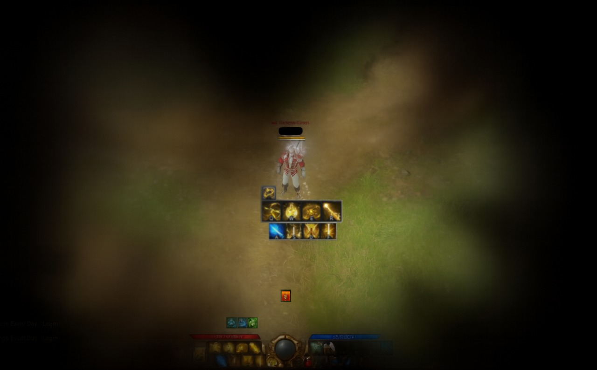
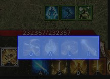
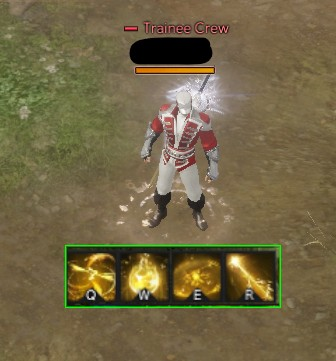
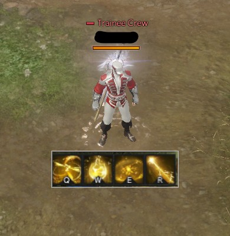

# Area Selector Accessibility App

## 🌐 Description

This application is designed to assist video game players with limited field of view or visual accessibility needs.
It enables precise selection of any region on the screen and magnifies it through an adjustable, accessibility-friendly zoom window (“Lupa”).

The tool lets players drag and zoom the magnifier directly, toggle passthrough mode (clicks go through the magnifier to the game), and control everything with **global hotkeys without leaving the game**.
The panel itself is built for low vision: large text (up to 200 %), a high-contrast theme, full keyboard navigation and screen-reader support, in **Portuguese or English**.
All settings are saved automatically, and the app can keep running in the **system tray**.
Everything ships as **one standalone `area_selector.exe`** — no installer, no extra files, no runtime DLLs.


---

### 🦉 How a Player With Low Vision Sees the Game


---

## 🚀 Quick Start (No Rust Required)

1. Download **`area_selector.exe`** from the [GitHub Releases](https://github.com/jfan-dev/area-selector-accessibility-app/releases) page.
2. Put it in any folder and double-click it.

That's it — the single executable contains the control panel, the area selector and the magnifier.
A short guide opens the first time; reopen it any time with the **?** button next to the title.

**Requirements:** Windows 10 or 11, 64-bit. Windows 10 version 2004 or newer is recommended: older versions work, but the magnifier can show itself when it overlaps the selected area.

---

## 🎮 How to Use

### The panel
| Part | What it does |
|------|--------------|
| **Status chips** (Area · Magnifier · Passthrough) | Show the current state and are also shortcuts: click *Area* to select a new one, *Magnifier* to open/close it, *Passthrough* to toggle it. |
| **Home** tab | *Select area*, open/close the magnifier, the **passthrough switch**, zoom (− / slider / +), refresh rate (FPS) and a **3×3 positioning pad** (corners and centre). Exact X/Y values are under *Advanced*. |
| **Hotkeys** tab | Change, remove or restore the global hotkeys (see below). Warns when a combination is used by another program or twice. |
| **Appearance** tab | Theme (same as Windows / light / dark) plus a **high contrast** switch — four colour schemes in total —, **text size 100–200 %**, language, close-to-tray, and the magnifier border (colour presets incl. a colour-blind-friendly one, thickness, mode badge). |
| **Quit** | Closes the app and the magnifier. |

Every control has a tooltip and can be reached with **Tab** (Space/Enter activates it); screen readers such as Windows Narrator announce the groups and controls.

### Selecting an area
*Select area* shows a dimmed screenshot of your screen with a crosshair: click and drag over the region to magnify — the size is shown next to the cursor. **ESC** or **right-click** cancels; selections smaller than 16 px are rejected.

### The magnifier
- **Drag it** to move it; **mouse wheel** or **+ / −** to zoom; **arrow keys** move it (Shift = 10 px); **P** turns passthrough on; **ESC** closes it.
- Green border + *Interactive* badge = you can drag/zoom it; grey border + *Passthrough* badge = clicks go through to the game.
- It keeps running while the panel is minimized or in the tray. Selecting a new area updates it right away.

### Global hotkeys (work inside games)
| Default | Action |
|---------|--------|
| **Ctrl+Alt+P** | Passthrough on/off |
| **Ctrl+Alt+L** | Open/close the magnifier |
| **Ctrl+Alt+A** | Select area |
| **Ctrl+Alt+PageUp / PageDown** | Zoom in / out |
| **Ctrl+Alt+H** | Show the panel |

### System tray
Closing the panel keeps the app running in the system tray (the first time, a short message explains it — turn it off under *Appearance → Window*). Click the tray icon to open the panel; right-click for a menu with the magnifier, passthrough, area selection and Quit.

> **Tip:** play in windowed or borderless fullscreen mode — in exclusive fullscreen, Windows hides overlay windows like the magnifier.

Settings are saved automatically to `%APPDATA%\area_selector\config.json`.

---

## ⌨️ Command-Line Modes

The same executable can open the selector or the magnifier on their own:

```bash
# Control panel (default)
area_selector.exe

# Only the fullscreen area selector — saves the area and exits
area_selector.exe seletor

# Only the magnifier
area_selector.exe lupa <x> <y> <width> <height> [zoom|passthrough] [pos_x pos_y]
```

- `x y width height` — region to magnify, in screen pixels.
- `zoom` — magnification (e.g. `2`); omitted = zoom from the saved settings. `passthrough` starts in click-through mode.
- `pos_x pos_y` — magnifier window position; also saved to the settings.

Invalid arguments print a usage message and exit with code 2.
Set `RUST_LOG=debug` to see detailed logs when starting from a terminal.

---

## 🦀 Requirements to Build the Project

- **Backend / Core Application:** Rust (2021 Edition, stable toolchain)
- **Frontend / UI:** egui + eframe
- **Target:** Windows (uses the Win32 API). It can be developed and cross-compiled from Linux/WSL — see below.

---

### 📥 Cloning the Repository

```bash
git clone https://github.com/jfan-dev/area-selector-accessibility-app.git
cd area-selector-accessibility-app/
```

---

### ▶️ Building and Running on Windows

```bash
# Run the control panel (debug build — keeps a console window for logs)
cargo run

# Command-line modes
cargo run -- seletor
cargo run -- lupa 100 100 300 200 2

# Optimized standalone executable (no console window)
cargo build --release
# → target/release/area_selector.exe
```

---

### 🐧 Building From Linux / WSL (Ubuntu)

The app uses the Windows API, so it only runs on Windows — but you can develop and cross-compile it from Linux or WSL2.
On WSL, the resulting `.exe` can be launched straight from the Linux shell and opens on the Windows desktop.

```bash
# 1. Install the MinGW-w64 cross-compiler
sudo apt update && sudo apt install -y build-essential mingw-w64

# 2. Install Rust and the Windows GNU target
curl --proto '=https' --tlsv1.2 -sSf https://sh.rustup.rs | sh
rustup target add x86_64-pc-windows-gnu

# 3. Build (aliases defined in .cargo/config.toml)
cargo wbuild --release
# → target/x86_64-pc-windows-gnu/release/area_selector.exe

# 4. Run (WSL only — opens on the Windows desktop)
cargo wrun --release

# Checks (tests run as Windows executables through WSL interop)
cargo wtest
cargo wclippy
cargo fmt --check
```

If running from inside the WSL filesystem is slow, copy `area_selector.exe` to the Windows side
(e.g. `/mnt/c/Users/<you>/area-selector/`) and run it from there.

---

### 🗂 Project Structure

| Path | Purpose |
|------|---------|
| `src/main.rs` | Entry point: command-line modes, DPI awareness, logging |
| `src/app.rs` | App state; owns the selector and magnifier windows, hotkeys and tray |
| `src/app/panel.rs` | Control panel UI (tabs, cards, dialogs) |
| `src/theme.rs` | Accessible theme (large text, high contrast, focus outline) |
| `src/i18n.rs` | Portuguese / English texts |
| `src/widgets.rs` | Accessible widgets and responsive layout helpers |
| `src/hotkeys.rs` | Global hotkeys |
| `src/tray.rs` | System tray icon and menu |
| `src/ui_selector.rs` | Fullscreen area selector |
| `src/lupa.rs` | Magnifier window |
| `src/capture.rs` | Screen capture (Win32 GDI) |
| `src/config.rs` | Settings load/save |
| `src/cli.rs` | Command-line argument parsing |
| `src/icon.rs` / `build.rs` | App icon and version info embedded in the exe |
| `IMPROVEMENT_PLAN.md` / `UX_PLAN.md` | Roadmaps of the quality and UI/UX improvements |

---

## 👑 Demonstration


---

### ✍🏻️ Additional Features

| Feature | Preview | Description |
|--------|---------|-------------|
| Area Selection Tool |  | Fullscreen drag-to-select with live selection preview |
| Magnifier Window |  | Zoomed region with adjustable zoom, position and FPS, updated live |
| Passthrough Mode |  | Lets clicks pass through the magnifier window |

---

## ✍🏻️ Technology Stack

| Technology | Purpose | Website |
|-----------|----------|---------|
| Rust | Core application | https://www.rust-lang.org/ |
| eframe / egui | Graphical UI framework and multi-window (viewport) support | https://github.com/emilk/egui |
| Windows API (`windows` crate) | GDI screen capture, capture exclusion, DPI awareness | https://learn.microsoft.com/windows |
| serde / serde_json | Persistent storage for config | https://serde.rs/ |
| global-hotkey | System-wide hotkeys | https://docs.rs/global-hotkey |
| tray-icon | System tray icon and menu | https://docs.rs/tray-icon |
| log / env_logger | Logging | https://docs.rs/env_logger |
| embed-resource | Icon and version info in the exe | https://docs.rs/embed-resource |

---

## 🛠 Challenges and Solutions

### 🟥 Problem — Persisting User Configuration  
Keeping area, zoom and position across sessions required a clean persistent solution integrated into user directories.  
**Solution:** implemented `AppConfig` using `serde_json` and stored it under the OS config path. Changes are auto-saved with a short debounce (so dragging a slider doesn't write the file every frame) and on exit, so there is no save button. New settings (like FPS) have defaults, so older config files keep working.

### 🟩 Problem — Click-Through Mode  
Switching between interactive and passthrough modes originally required editing the window's extended styles (`WS_EX_TRANSPARENT`) through a window handle saved to a file, then restarting the magnifier.  
**Solution:** the magnifier is now an egui viewport, and click-through is a viewport property (`with_mouse_passthrough`) that is toggled in place — no restart, no handle file.

### 🟦 Problem — High CPU Usage & Memory Leak During Selection

Originally, the selection overlay (the blue rectangle drawn during area selection) was rendered every frame at ~60 FPS while also capturing screen data using the scrap crate.
This caused unnecessary GPU/CPU usage and a visible memory leak, especially on 4K monitors, because the capture pipeline and rendering loop were being executed far more often than necessary.

**Solution:** replaced scrap with direct Win32 GDI capture (`BitBlt`). The capturer now reuses its buffers between frames and releases all GDI handles automatically, and the selector only redraws when the mouse or keyboard is used.

### 🟨 Problem — Three Executables in One Folder

The panel, selector and magnifier used to be three programs (`area_selector.exe`, `seletor.exe`, `lupa.exe`) that talked through command-line arguments and files, had to stay in the same folder, and couldn't react to setting changes.  
**Solution:** merged into a single executable using egui multi-viewports. The magnifier is a *deferred* viewport with its own repaint loop, so it keeps updating even while the panel is minimized, and slider changes reach it immediately.

### 🟪 Problem — The Magnifier Magnifying Itself

When the magnifier window overlapped the selected area, it captured its own image.  
**Solution:** the magnifier window is excluded from screen capture with `SetWindowDisplayAffinity(WDA_EXCLUDEFROMCAPTURE)`.

### 🟧 Problem — Display Scaling (125%, 150%…)

Mouse positions are in logical points while screen capture uses physical pixels, so on scaled displays the wrong region was magnified.  
**Solution:** the process is per-monitor DPI aware, areas are stored in physical pixels, and zoom means true magnification at any scaling.

### ♿ Problem — A Panel Usable With Low Vision

The original panel had small default text, colour-only state and no keyboard or screen-reader support — for an app whose users have low vision.
**Solution:** an accessible theme whose contrast ratios are unit-tested against WCAG, text size up to 200 % with a responsive layout (checked by a headless layout test at many window widths), named accessibility groups for screen readers, and global hotkeys so a passthrough magnifier can be controlled without leaving the game.

---

## 🐛 Known Bugs / Limitations

- **Primary monitor only.** The area selector covers the primary monitor.
- **Selector background is a still screenshot** taken when you click *Select area* (secondary windows weren't see-through with eframe's glow renderer on Windows), so animations behind it are frozen while you select.
- **The magnifier doesn't appear in screen recordings or streams** (OBS, Discord), a side effect of excluding it from capture.
- **Exclusive fullscreen games hide the magnifier** (a Windows limitation for overlay windows) — use windowed or borderless fullscreen.
- **Areas saved by older versions on scaled displays** may point to the wrong region — select the area again once.

---

## 🐼 Developed by

**Jaime Fernandes**  
📧 jfernan10@gmail.com  
🔗 https://www.linkedin.com/in/jfan-dev
